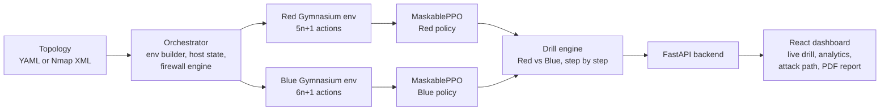
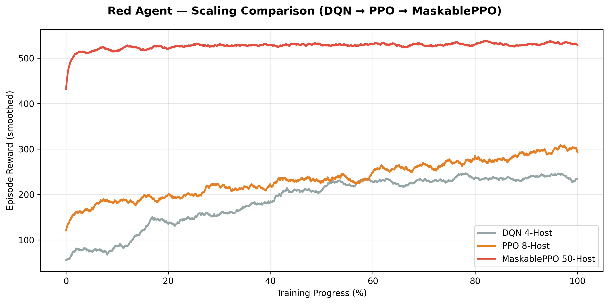
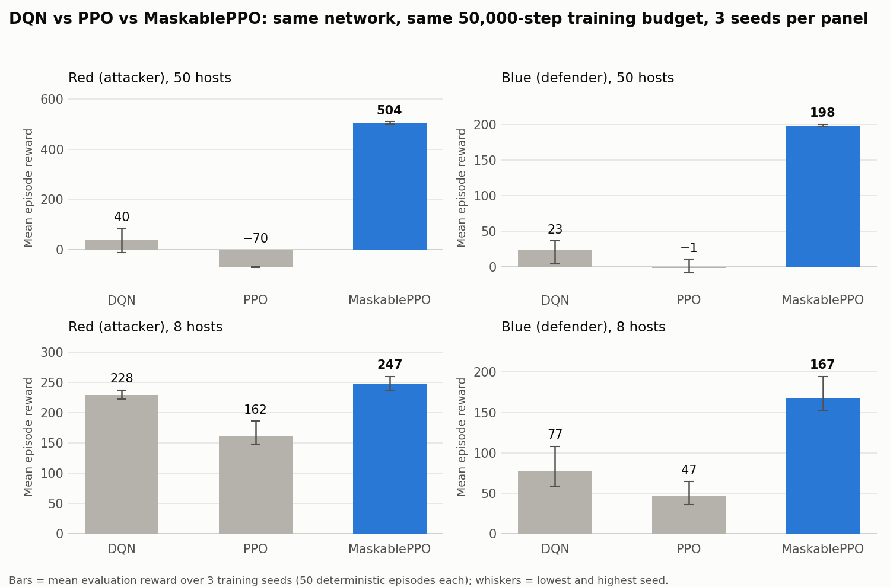
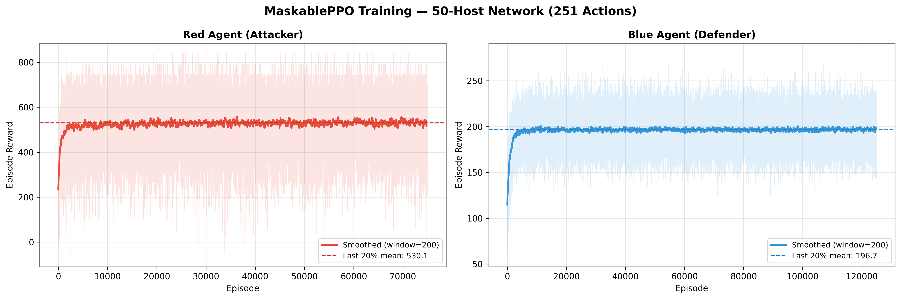
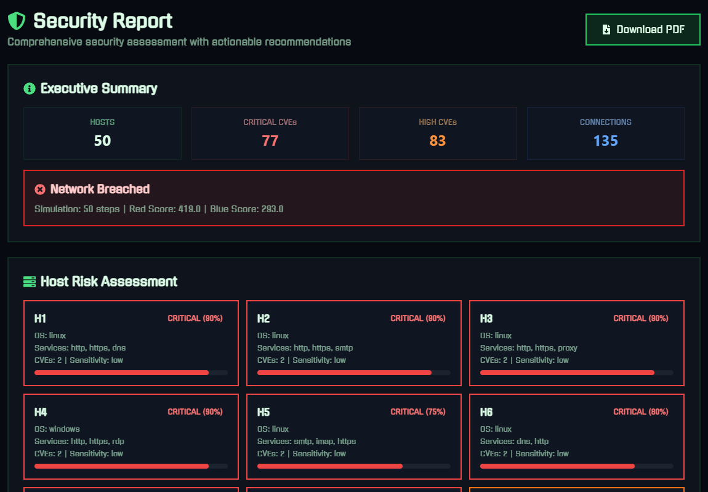
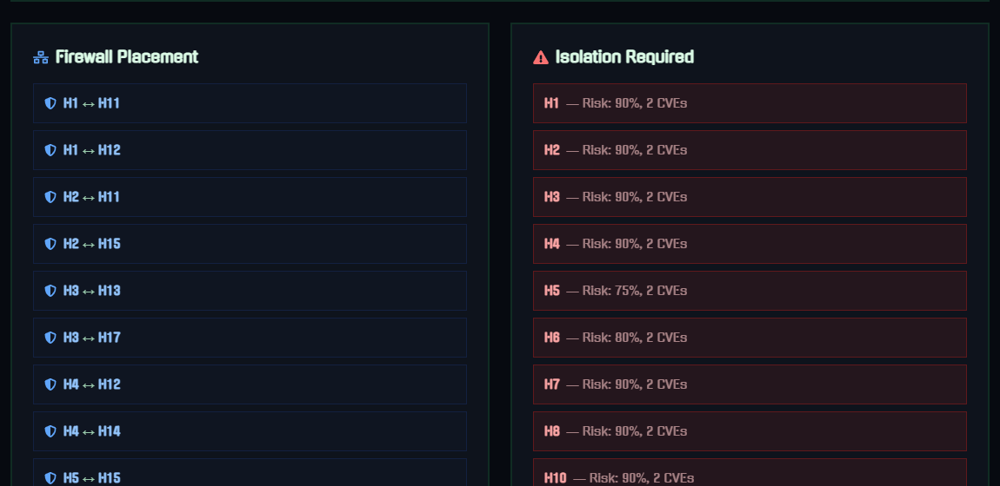

# AI-Powered Cyber Drill System

**Reinforcement-learning Red Team vs Blue Team cyber drills on simulated enterprise networks of up to 50 hosts.**


> Final Year Project, **BS Computer Science, FAST-NUCES Lahore** (2026), supervised by **Dr. Ammar Haider**. Grade: **A**.

An attacker agent (**Red**) and a defender agent (**Blue**) learn their strategies through reinforcement learning in a custom cyber range. You upload a network (YAML or an **Nmap XML scan**), and the trained agents play out a full attack-and-defence drill step by step in a web dashboard. Each drill produces analytics, the attacker's reconstructed attack path, and a downloadable **PDF security report** with CVE details, MITRE ATT&CK tactic mapping and remediation priorities.


*Live drill on the 50-host network: the trained agents play step by step. In step 31, Blue's firewall blocks Red's exploit attempt.*

---

## Highlights

- **Custom Gymnasium environments** for the Red and Blue agents, built from scratch: network state, host vulnerabilities, access levels, isolation and firewall status.
- **MaskablePPO** (Stable-Baselines3 / `sb3-contrib`) with **action masking**, so agents only choose actions that are valid in the current network state. This is what made a 50-host network (251 Red / 301 Blue actions) trainable.
- **Iterative RL engineering:** the project progressed from DQN on 2–8 hosts, to PPO on 8 hosts, to MaskablePPO on 50 hosts. In a controlled benchmark (same network, budget and seeds), **MaskablePPO beat DQN and PPO in every setting**, by about 12× in Red reward on 50 hosts (see [How the project evolved](#how-the-project-evolved)).
- **Security grounding:** real CVE identifiers per host (e.g. Log4Shell, PrintNightmare, EternalBlue), NIST NVD lookup with CVSS scores, MITRE ATT&CK tactic mapping for every action, a simulated firewall engine, and a segmented DMZ / internal / database network design.
- **Nmap XML import:** convert a scan into a drill topology, review host sensitivity and links, then run it.
- **Full-stack platform:** FastAPI backend (40 REST endpoints, per-user data, token auth) and a React dashboard with live drill playback, analytics, a network monitor and PDF report export.
- **126 automated tests** (pytest) covering environments, agents, reward engine, topology loading, SB3 compatibility and the API.

---

## How it works



1. **Topology:** hosts with OS, services, CVEs and a sensitivity level (low / medium / high), plus the network links between them.
2. **Training:** each agent learns with MaskablePPO against a scripted (rule-based) opponent: Red trains against a heuristic defender and Blue against a heuristic attacker. Models are saved per topology in `results/models/`.
3. **Drill (neural network vs neural network):** the trained Red and Blue policies are loaded together and play against each other in real time. The dashboard streams every step, and the backend builds the attack path, host risk scores and the report. During playback the Red policy's actions are sampled with a small action-type rotation rule, so the full attack chain (scan → exploit → escalate → lateral movement → exfiltration) unfolds instead of one action repeating.

### Action spaces

For a network with `n` hosts, Red has `5n + 1` actions and Blue has `6n + 1` (one per action type per host, plus *idle*).

| Red (attacker) | MITRE ATT&CK tactic | Blue counter-action |
|---|---|---|
| Scan | Discovery (TA0007) | Detect |
| Exploit | Initial Access (TA0001) | Patch |
| Escalate | Privilege Escalation (TA0004) | Harden |
| Lateral Move | Lateral Movement (TA0008) | Isolate / Deploy Firewall |
| Exfiltrate | Exfiltration (TA0010) | Restore |

**Action masking** removes invalid choices at every step, for example exploiting an already-compromised or isolated host, escalating without access, exfiltrating from an uncompromised host, or deploying a firewall that is already active.

**Rewards** are shaped by security outcomes. Red is rewarded for new compromises, privilege escalation and data exfiltration (weighted by host sensitivity). Blue is rewarded for detecting, isolating and restoring compromised hosts and for firewalls that block lateral movement. Wasted actions are penalised for both.

---

## How the project evolved

| Stage | Algorithm | Network size | Outcome |
|---|---|---|---|
| 1 | Custom DQN (PyTorch) | 2–8 hosts | Prototype that showed the environment and reward design could be learned. |
| 2 | **DQN** (Stable-Baselines3) | 2, 4, 8 hosts | Red learned well, but the **Blue agent's reward collapsed on 8 hosts** as the action space grew (curves in [`results/history/dqn/`](results/history/dqn)). |
| 3 | **PPO** (Stable-Baselines3) | 8 hosts | Moved to the policy-gradient family because `sb3-contrib` supports invalid-action masking for PPO (there is no masked DQN). Plain PPO showed the real bottleneck: most actions in a large network are invalid, and an unmasked agent wastes its training on them. |
| 4 | **MaskablePPO** (`sb3-contrib`) | **50 hosts** | PPO plus action masking: no invalid actions, stable across seeds, and both agents converged within about 5,000 episodes on a 50-host network with 251 / 301 actions. |



*Development-history curves. Each run used a different network size (4, 8 and 50 hosts), and reward grows with network size, so these curves show the progression rather than a like-for-like comparison. The controlled comparison follows.*

### Controlled comparison: DQN vs PPO vs MaskablePPO

To compare the algorithms fairly, all three were re-trained on **the same network** with **the same budget (50,000 steps)**, the same hyperparameters as the project's training scripts, and **3 random seeds each**. Each trained policy was then evaluated on the same 50 episodes.



**MaskablePPO came out best in all four settings, and the gap grows with network size.** On 50 hosts, its Red agent scored about 504 against 40 (DQN) and −70 (PPO), and its Blue agent scored 198 against 23 and −1.

Security outcomes per evaluation episode (mean of 3 seeds):

| Setting | Measure | DQN | PPO | MaskablePPO |
|---|---|---:|---:|---:|
| Red, 50 hosts | Hosts compromised by Red ↑ | 0.6 | 1.0 | **12.9** |
| Red, 50 hosts | Invalid actions chosen ↓ | 19% | 94% | **0%** |
| Blue, 50 hosts | Hosts compromised at end ↓ | 3.5 | 3.5 | **2.8** |
| Red, 8 hosts | Hosts compromised by Red ↑ | 4.1 | 4.1 | **6.1** |
| Blue, 8 hosts | Hosts compromised at end ↓ | 2.6 | 2.7 | **0.9** |
| Blue, 8 hosts | Invalid actions chosen ↓ | 49% | 16% | **0%** |

Plain PPO scored below DQN at this budget. DQN reuses past experience from a replay buffer, so it learns more from a short run, while PPO uses each batch once and, without masking, its Red agent on 50 hosts spent 94% of its steps on actions that could not succeed. DQN, however, was unstable: its Blue agent's reward collapsed on 8 hosts in the original training runs, and its 50-host Red results varied widely between seeds (−11 to 84). Masking fixes PPO's weakness, which is why MaskablePPO leads in every setting. Rewards are only comparable within one panel, because reward scales with network size and differs between Red and Blue. Raw results are in [`results/benchmark/`](results/benchmark); reproduce with `orchestrator/benchmark_algorithms.py`.

### Final 50-host training



The Red agent trained for about 75,000 episodes and the Blue agent for about 125,000. Smoothed episode reward rose from ≈230 to ≈530 for Red and from ≈115 to ≈197 for Blue, then stabilised. Per-episode logs are in `results/csv/`.

---

## Screenshots

| Reward timeline of a drill | 50-host network analytics |
|---|---|
|  |  |

**Reconstructed Red attack path:** entry point, lateral movements and exfiltrated hosts.


**Security report:** executive summary and per-host risk assessment, followed by the firewall engine's recommended rules and the hosts that need isolation.





**PDF report** generated by the backend (ReportLab): cover, simulated firewall rules, and MITRE ATT&CK mapping with remediation priorities.


---

## Tech stack

| Area | Technologies |
|---|---|
| Reinforcement learning | Stable-Baselines3, `sb3-contrib` (MaskablePPO), PPO, DQN, Gymnasium, PyTorch, NumPy |
| Cybersecurity | MITRE ATT&CK (tactics), CVE data + NIST NVD API (CVSS), Nmap XML parsing, simulated firewall / network segmentation |
| Backend | FastAPI, SQLAlchemy, SQLite, Pydantic, ReportLab (PDF reports) |
| Frontend | React 18, Vite, Tailwind CSS, Recharts, React Router |
| Testing | pytest (126 tests) |

---

## Getting started

**Requirements:** Python 3.10+, Node.js 18+.

```bash
# backend
python -m venv venv
venv\Scripts\activate            # Windows  (macOS/Linux: source venv/bin/activate)
pip install -r requirements.txt
uvicorn backend.main:app --reload --reload-dir backend --reload-dir orchestrator --port 8000
```

```bash
# frontend (second terminal)
cd frontend
npm install
npm run dev
```

Open `http://localhost:5173`, register a user, go to **AI Orchestrator** and upload `examples/topology_50host.yaml`. Pre-trained models for this network are included, so the drill starts immediately. More example networks are described in [`examples/`](examples).

For anything beyond local use, set your own token-signing key: `DRILL_SECRET_KEY=<random value>`.

### Train agents for a new network

```bash
python -m orchestrator.train_maskable_ppo_red  path/to/topology.yaml 100000
python -m orchestrator.train_maskable_ppo_blue path/to/topology.yaml 100000
```

Models are saved as `results/models/maskable_ppo_{red|blue}_{topology}.zip` and are picked up automatically by the drill engine. Training can also be started from the web UI.

### Reproduce the algorithm comparison

```bash
python -m orchestrator.benchmark_algorithms examples/topology_50host.yaml red 50000 0,1,2 50
```

### Run the tests

```bash
pytest
```

---

## Project structure

```
backend/        FastAPI app: routers, services (simulation, reports, PDF, CVE lookup, training), tests
frontend/       React + Vite dashboard (see frontend/README.md)
orchestrator/   RL core: Gymnasium envs, env builder, reward engine, firewall engine,
                Nmap parser, rule-based opponents, training + benchmark scripts, tests
examples/       Example topologies (50-host enterprise, 10-host, Nmap XML)
results/        Trained models, reward logs, training plots, benchmark results, DQN history
docs/           Screenshots
scripts/        Synthetic Nmap scan generator
```

---

## Limitations and future work

**Current limitations**
- The cyber range is an **abstract simulation**: actions change modelled host state and nothing is exploited for real. Success probabilities and rewards are design choices, not measured values.
- Agents are trained **per topology**, so a new network needs its own training run.
- Each agent **learns** against a scripted opponent. The two trained networks compete in live drills, but they are not yet trained against each other (self-play).
- For Nmap imports, CVEs are suggested from detected services and network links are inferred, because Nmap output contains no topology. Both should be reviewed before running a drill.
- MITRE ATT&CK mapping is at **tactic** level, not individual techniques.
- Authentication is a simple signed-token scheme intended for local and demo use.

**Future work**
- **Self-play:** train Red and Blue against each other's learned policies, so each adapts to an evolving opponent.
- Policies that generalise across networks (e.g. graph neural network encoders).
- Technique-level ATT&CK mapping and richer attacker behaviours.
- Feeding real telemetry (SIEM logs, vulnerability scanners) into the environment.

---

## Acknowledgements

Developed as a Final Year Project at FAST-NUCES Lahore under the supervision of **Dr. Ammar Haider**.

## License

[MIT](LICENSE)
