# AI-Powered Cyber Drill System

**Simulation-based security assessment: a self-trained AI attacker and defender run thousands of drills on a digital twin of your network and rate its breach likelihood on the NIST SP 800-30 scale.**


> Final Year Project, **BS Computer Science, FAST-NUCES Lahore** (2026), supervised by **Dr. Ammar Haider**. Grade: **A**.

You upload a network (YAML or an **Nmap XML scan**). An attacker agent (**Red**) and a defender agent (**Blue**), trained against each other with reinforcement learning, then play out attack-and-defence drills on a safe simulated copy of it. Nothing touches the real network.

From those drills the system answers three questions:

1. **How likely is a breach?** It runs 30 drills with the network's current controls only and 30 with the AI defender, and rates each breach rate on the likelihood scale of **NIST SP 800-30 Rev. 1, Table G-4** (Very Low to Very High), with a 95% confidence range.
2. **What should the defenders do?** An **AI Defence Playbook** built from what the trained defender actually did: what to protect first, which hosts to harden, and how it responded during attacks.
3. **What would fixing things in advance change?** A **what-if** run applies the top 10 fixes to a copy of the network and re-runs the assessment, so you see the before and after.

Every drill also produces the attacker's reconstructed path, MITRE ATT&CK tactic mapping, CVE details with CVSS scores, and a downloadable **PDF security report**.

<!-- demo video link goes here -->

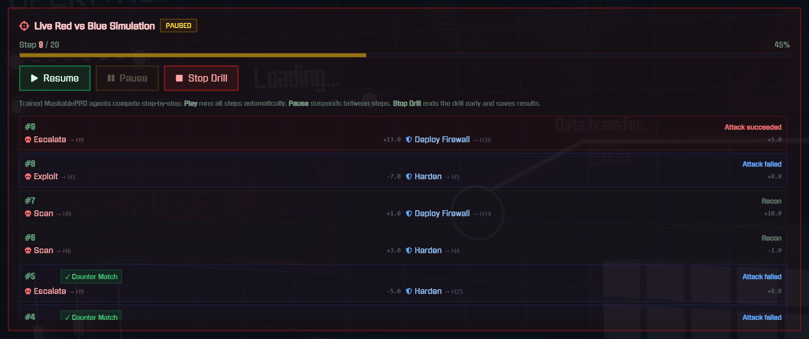
*Live drill on the 50-host network: every step shows the attacker's move, the defender's response and whether the attack worked.*

---

## Highlights

- **Self-play training:** Red and Blue learn against each other in alternating rounds. Each new round faces a pool of all earlier versions of the opponent, so neither side overfits to one strategy. The 50-host agents trained for 8 rounds (2 million steps each).
- **Custom Gymnasium environments** built from scratch: host vulnerabilities, access levels, reachability (an attacker needs an internet-facing host or a foothold next to the target), isolation and firewall state.
- **MaskablePPO** (`sb3-contrib`) with **action masking**, so agents only pick actions that are valid in the current state. This is what makes a 50-host network (251 Red / 301 Blue actions) trainable.
- **Standards-based rating:** breach likelihood on the NIST SP 800-30 Rev. 1 scale, a clear per-drill breach rule (any data stolen, or more than 20% of hosts compromised), MITRE ATT&CK tactics for every action, and real CVE identifiers with NIST NVD lookup.
- **Nmap XML import:** turn a scan into a drill network, review host sensitivity and links, then assess it.
- **Full-stack platform:** FastAPI backend (44 REST endpoints, per-user data, token auth, background assessment jobs) and a React dashboard with live drill playback, analytics, a network monitor, the security report and PDF export.
- **291 automated tests** (pytest) covering environments, masks, rewards, reachability, self-play, assessment, playbook, what-if and the API.

---

## How it works

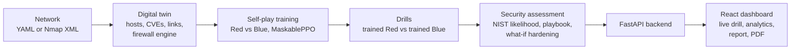

1. **Network:** hosts with OS, services, CVEs, a sensitivity level (low / medium / high) and the links between them. Internet-facing hosts are the attacker's possible entry points.
2. **Training:** Red and Blue are trained in rounds with self-play. Models are saved per network in `results/models/`.
3. **Drill:** the two trained policies play against each other step by step. A drill is **BREACHED** if any data is stolen or more than 20% of hosts are compromised, otherwise **DEFENDED**.
4. **Assessment:** many drills per mode give a breach rate, which is mapped to the NIST likelihood level and turned into the playbook and the what-if comparison.

### Action spaces

For a network with `n` hosts, Red has `5n + 1` actions and Blue has `6n + 1` (one per action type per host, plus *idle*).

| Red (attacker) | MITRE ATT&CK tactic | Blue counter-action |
|---|---|---|
| Scan | Discovery (TA0007) | Detect |
| Exploit | Initial Access (TA0001) | Patch |
| Escalate | Privilege Escalation (TA0004) | Harden |
| Lateral Move | Lateral Movement (TA0008) | Isolate / Deploy Firewall |
| Exfiltrate | Exfiltration (TA0010) | Restore |

**Action masking** removes invalid choices at every step: exploiting a host that is unreachable or not yet scanned, escalating without access, exfiltrating without root, or deploying a firewall that is already active.

**Rewards** follow security outcomes. Red earns rewards for new compromises, escalation and data theft (more for sensitive hosts). Blue earns rewards for stopping attacks and gets a large bonus or penalty at the end of each episode depending on whether the network was breached. Scanning and detecting only pay when they reveal something new.

### Breach likelihood scale (NIST SP 800-30 Rev. 1, Table G-4)

| Breach rate over the drills | Likelihood |
|---:|---|
| 96–100% | Very High |
| 80–95% | High |
| 21–79% | Moderate |
| 5–20% | Low |
| 0–4% | Very Low |

---

## Results

### Security assessment on the 50-host network

Each mode runs 30 drills of 15 steps. The trained attacker is the same in every mode.

| Mode | Breach rate | NIST likelihood |
|---|---:|---|
| Current security (network's own controls, no active defence) | 97–100% | **Very High** |
| With AI defence (trained Blue agent) | 50–83% | **Moderate** to **High** |
| After the top 10 what-if fixes (no active defence) | 0–10% | **Very Low** to **Low** |

Ranges cover repeated assessments, since each one samples new drills. The AI defender lowers the risk during an attack, but fixing the main entry points in advance has the largest effect.

### Self-play training

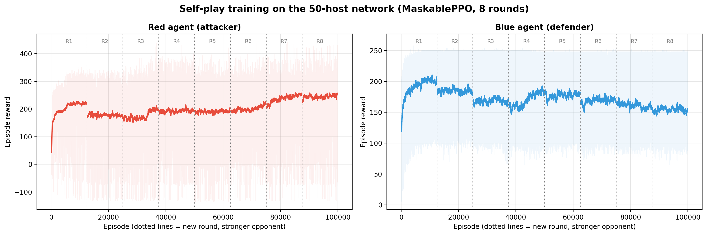

Within each round the learning side improves quickly. When the next round starts, it faces a stronger opponent, so its reward drops and climbs again. Over 8 rounds the attacker's reward keeps rising while the defender holds a steady level against ever stronger attackers.

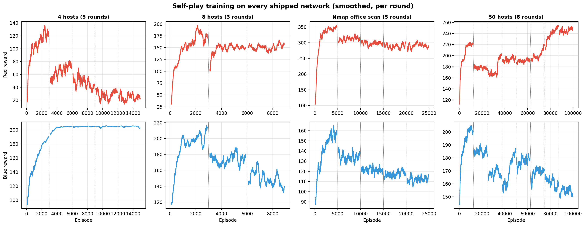

Trained models are included for all four networks (4 hosts, 8 hosts, a 12-host Nmap office scan and 50 hosts). On the 4-host network the defender learns to shut the only entry point, so the attacker's reward falls round after round. Reward logs are in `results/csv/`.

### Why MaskablePPO

The agents were first built with DQN and plain PPO. DQN's Blue agent collapsed on 8 hosts as the action space grew (curves in [`results/history/dqn/`](results/history/dqn)). Plain PPO showed the real bottleneck: in a large network most actions are invalid at any moment, and an unmasked agent spends most of its training on them. MaskablePPO keeps PPO's stability and removes invalid actions entirely, which made the 50-host network trainable. `orchestrator/benchmark_algorithms.py` compares the three algorithms on any network.

---

## Screenshots

**Security assessment:** breach likelihood with the network's current controls and with the AI defender, rated on the NIST SP 800-30 scale, with the most attacked hosts and the CVEs the attacker used.

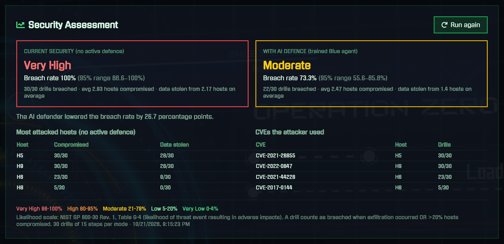

| AI Defence Playbook | What-if hardening |
|---|---|
| 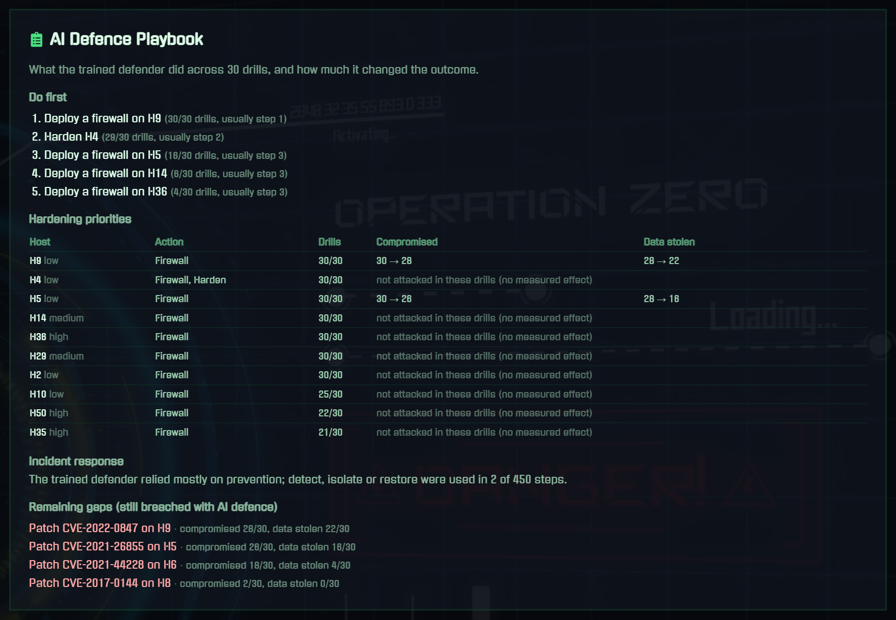 | 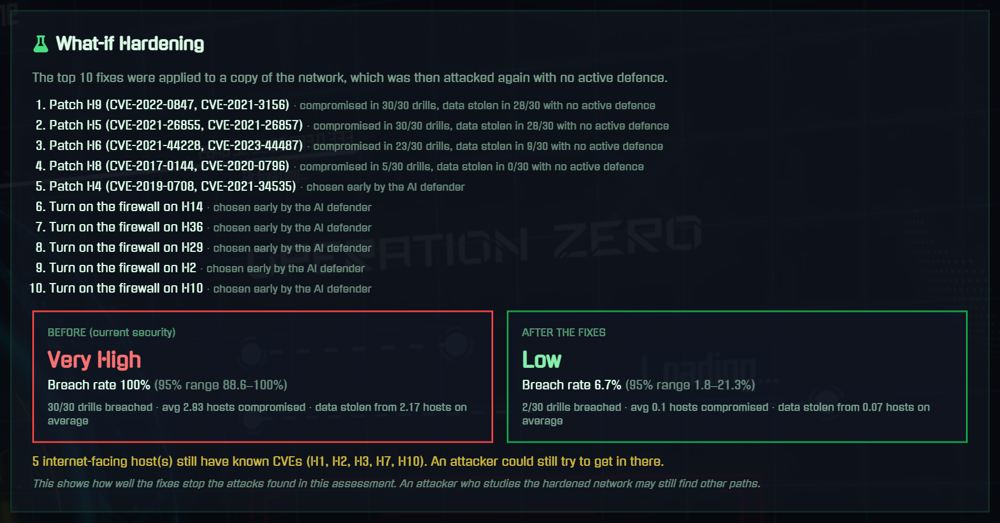 |

| Drill results and reward timeline | 50-host network analytics |
|---|---|
| 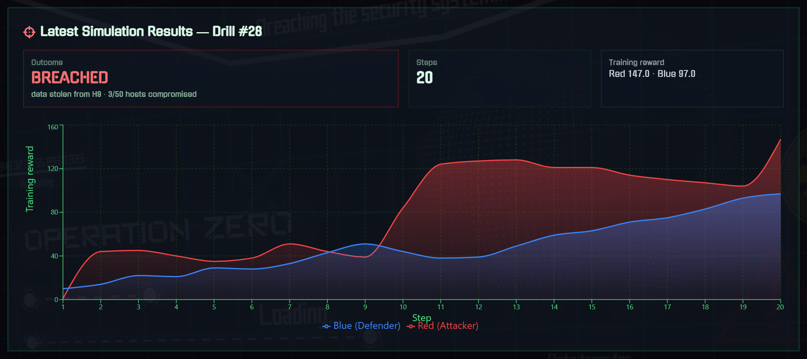 | 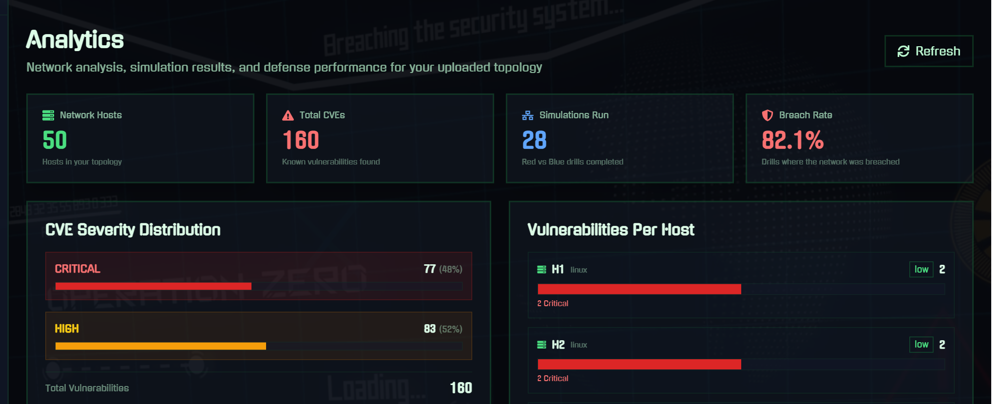 |

**Reconstructed Red attack path:** entry point, compromised hosts and stolen data.

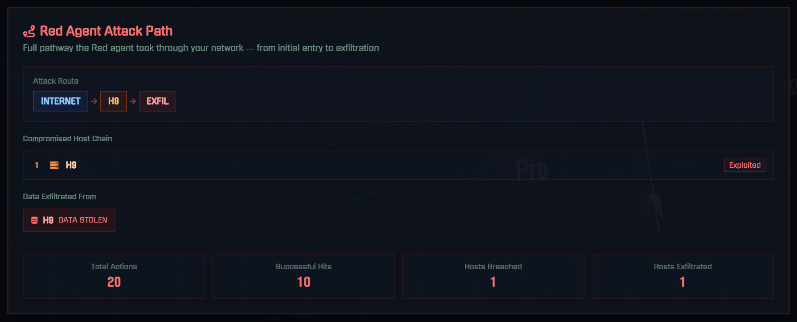

**PDF security report:** cover, security assessment and what-if hardening pages.

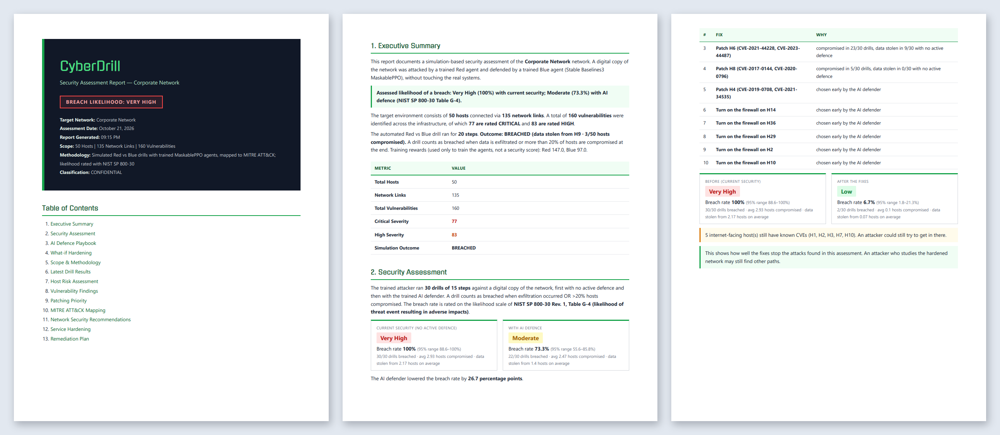

---

## Tech stack

| Area | Technologies |
|---|---|
| Reinforcement learning | Stable-Baselines3, `sb3-contrib` (MaskablePPO), self-play, Gymnasium, PyTorch, NumPy |
| Cybersecurity | NIST SP 800-30 likelihood scale, MITRE ATT&CK (tactics), CVE data + NIST NVD API (CVSS), Nmap XML parsing, simulated firewall / network segmentation |
| Backend | FastAPI, SQLAlchemy, SQLite, Pydantic, ReportLab (PDF reports) |
| Frontend | React 18, Vite, Tailwind CSS, Recharts, React Router |
| Testing | pytest (291 tests) |

---

## Getting started

**Requirements:** Python 3.10+, Node.js 18+.

```bash
# backend
python -m venv venv
venv\Scripts\activate            # Windows  (macOS/Linux: source venv/bin/activate)
pip install -r requirements.txt
uvicorn backend.main:app --reload --reload-dir backend --reload-dir orchestrator --port 8000
```

```bash
# frontend (second terminal)
cd frontend
npm install
npm run dev
```

Open `http://localhost:5173`, register a user, go to **AI Orchestrator** and upload `examples/topology_50host.yaml`. Trained models for this network are included, so drills start immediately. Then open **Security Report** and click **Run security assessment**. More example networks are described in [`examples/`](examples).

For anything beyond local use, set your own token-signing key: `DRILL_SECRET_KEY=<random value>`.

### Train agents for a new network

Self-play training (what the included models use):

```bash
python -m orchestrator.train_adversarial path/to/topology.yaml --mode selfplay --rounds 8 --steps 250000 --out results/selfplay/my_network
```

Each round saves `round_N/red.zip` and `round_N/blue.zip`. Copy the last round to `results/models/maskable_ppo_{red|blue}_{topology}.zip` and the app picks them up. Quick single-agent training can also be started from the web UI.

### Run the tests

```bash
pytest
```

---

## Project structure

```
backend/        FastAPI app: routers, services (simulation, assessment, reports, PDF, CVE lookup, training), tests
frontend/       React + Vite dashboard (see frontend/README.md)
orchestrator/   RL core: Gymnasium envs, env builder, action masks, reward engine, firewall engine,
                self-play training, assessment, playbook, what-if, Nmap parser, tests
examples/       Example networks (50-host enterprise, 10-host, Nmap XML)
results/        Trained models, reward logs, training plots, DQN history
docs/           Screenshots
scripts/        Synthetic Nmap scan generator
```

---

## Roadmap

- Policies that generalise across networks (e.g. graph neural network encoders), so one model covers any network.
- Partial observability: the attacker only sees what it has scanned, the defender only what it has detected.
- Technique-level ATT&CK mapping and feeding real telemetry (SIEM logs, vulnerability scanners) into the twin.

---

## Acknowledgements

Developed as a Final Year Project at FAST-NUCES Lahore under the supervision of **Dr. Ammar Haider**.

## License

Copyright (c) 2026 Muhammad Armaghan Tariq. All rights reserved. See [LICENSE](LICENSE).
